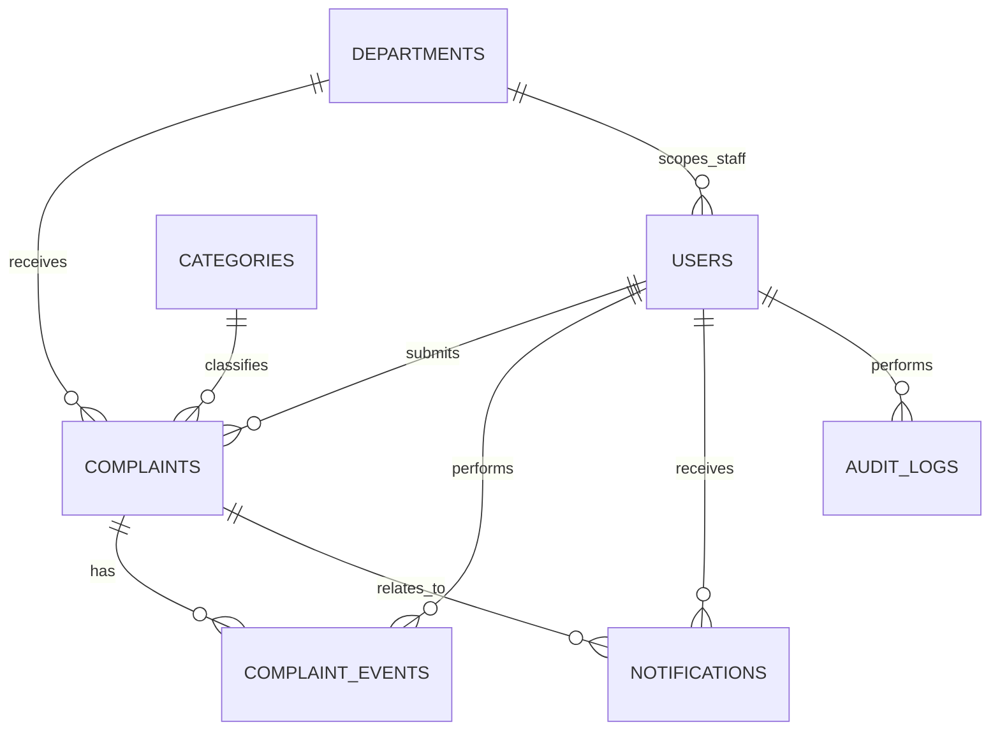

# MongoDB Data Model and Index Design

**Milestone:** 2 - System design
**Status:** Draft for review

## 1. Design principles

- MongoDB is accessed only from FastAPI.
- Store UTC timestamps; serialize as ISO 8601 UTC strings at the API boundary.
- Use MongoDB ObjectIds internally; expose opaque complaint references externally.
- Keep user, department, category, complaint, notification, audit and public content concerns in separate collections.
- Embed small, bounded snapshots useful to a complaint's history; reference growing event streams and notifications by ID.
- Deactivate rather than delete departments/categories/users referenced by historical cases.
- Never store plaintext passwords, email credentials or raw attachment content in complaint documents.

## 2. Collections

### `users`

```json
{
      "_id": "ObjectId",
  "email": "citizen@example.org",
  "email_normalized": "citizen@example.org",
  "password_hash": "...",
  "display_name": "Example Citizen",
  "phone": null,
  "role": "citizen",
  "department_id": null,
  "is_active": true,
  "email_verified_at": null,
  "created_at": "UTC datetime",
  "updated_at": "UTC datetime",
  "last_login_at": null
}
```

Roles are `citizen`, `administrator`, `department_head`, `department_officer`. Public visitors have no user document. Staff account creation is administrator-only. A staff user is assigned one active department in the initial design; multi-department staff access would require an explicit later design change. Password hash is never returned by the API.

### `departments`

`_id`, `name`, `slug`, `description`, `contact_public` (optional safe data), `is_active`, `created_at`, `updated_at`, `created_by`. Deactivation prevents new assignments/submissions but preserves historical case references.

### `categories`

`_id`, `name`, `description`, `is_active`, `sort_order`, `created_at`, `updated_at`, `created_by`. Category applicability may be global initially; if department-specific categories are required, add an optional `department_ids` field as a design change.

### `complaints`

```json
{
  "_id": "ObjectId",
  "reference": "PC-<random-opaque-token>",
  "citizen_id": "ObjectId",
  "subject": "Streetlight not working",
  "description": "...",
  "department_id": "ObjectId",
  "department_name_snapshot": "Public Works",
  "category_id": "ObjectId",
  "category_name_snapshot": "Infrastructure problems",
  "location": null,
  "incident_date": null,
  "priority": "normal",
  "status": "submitted",
  "assigned_officer_id": null,
  "attachments": [],
  "created_at": "UTC datetime",
  "updated_at": "UTC datetime",
  "due_at": null,
  "resolved_at": null,
  "closed_at": null,
  "feedback": null
}
```

`attachments` is a bounded metadata array (attachment ID, original display name, media type, byte size, storage key, uploaded_by, uploaded_at, scan status). Files reside in private object storage. Feedback is at most one citizen feedback record per complaint in MVP: rating 1–5, comment, adequately_addressed boolean, created_at, reopen_requested_at, reopen_review_status, reopen_reviewed_by, reopen_reviewed_at, reopen_review_comment. Access to feedback is scoped by case permissions.

Do not embed an unbounded status history, conversation, or audit trail in this document.

### `complaint_events`

Append-oriented case timeline collection. Each event contains `_id`, `complaint_id`, `event_type`, `actor_id` (nullable for system events), `actor_role_snapshot`, `from_status`/`to_status` when relevant, `visibility` (`citizen` or `internal`), `message`/structured payload as appropriate, `created_at`, and optional assignment/resolution data. Never return `internal` events to citizens. Avoid storing unnecessary sensitive data in event text.

### `notifications`

`_id`, `recipient_user_id`, `complaint_id` (optional), `type`, `title`, `body_safe`, `read_at`, `created_at`, `delivery_channels`, `email_status`, `email_attempted_at`. Notification content should avoid sensitive complaint details; the authenticated portal is the place to view case specifics.

### `audit_logs`

`_id`, `actor_user_id` (nullable for system), `action`, `target_type`, `target_id`, `department_id` (if relevant), `occurred_at`, `request_id`, `outcome`, `metadata_safe`. Append-only application behavior; access system-wide only to administrators. Do not log passwords, tokens, full request bodies, complaint evidence, or secrets. Define retention and tamper-resistance operationally before production.

### `announcements`

`_id`, `title`, `body`, `status` (`draft`/`published`/`archived`), `publish_at`, `expires_at`, `created_by`, `created_at`, `updated_at`. Editing permissions and public presentation are admin-managed. FAQ and guidelines may be static frontend content initially; revisit if non-developer editing is required.

## 3. Relationships



MongoDB stores these references as ObjectIds rather than relational foreign keys. The backend validates referenced records and authorization. Complaint snapshots preserve readable historical names if a department/category is renamed.

## 4. Indexes and uniqueness

Create and verify indexes as part of application startup/migration tooling (not ad hoc per request):

- `users.email_normalized`: unique.
- `users.role, users.department_id, users.is_active`: staff lookup and scope filters.
- `departments.slug`: unique; `departments.is_active` for directory/admin lists.
- `categories.name`: normalized uniqueness policy to be defined; `categories.is_active, categories.sort_order` for selection lists.
- `complaints.reference`: unique.
- `complaints.citizen_id, complaints.created_at desc`: citizen case listing.
- `complaints.department_id, complaints.status, complaints.updated_at desc`: department queue/dashboard.
- `complaints.assigned_officer_id, complaints.status, complaints.updated_at desc`: officer queue.
- `complaints.status, complaints.due_at`: overdue monitoring.
- `complaint_events.complaint_id, complaint_events.created_at`: chronological case timeline.
- `notifications.recipient_user_id, notifications.read_at, notifications.created_at desc`: inbox.
- `audit_logs.occurred_at desc`; scoped filters on `actor_user_id` and `target_type, target_id` as required.
- `announcements.status, announcements.publish_at, announcements.expires_at`: public feed.

Avoid a TTL index for complaint/audit content until approved retention rules exist.

## 5. Consistency and concurrency

Updates that must agree (complaint status/assignment and corresponding event/audit entries) should use a MongoDB transaction on an Atlas replica-set deployment. If transaction support is not available in a local/test setup, fail clearly or use a deliberately designed outbox strategy; do not silently report success after only part of a workflow is written. Use conditional updates on current status/version to prevent conflicting transitions. A future `version` field can support optimistic concurrency if needed.

## 6. Data lifecycle and unresolved decisions

- Configure backup and restore, retention, deletion/anonymization, and audit retention before production.
- Define file size/type limits, malware scanning, private access, retention, and storage provider before attachment implementation.
- Define whether departments can have tailored categories.
- Define normalization/uniqueness rules for department/category names.
- Seed only synthetic local development data; never commit credentials or production data.
