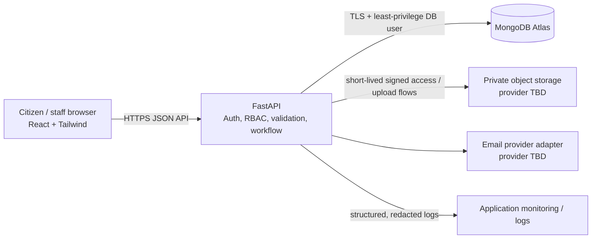
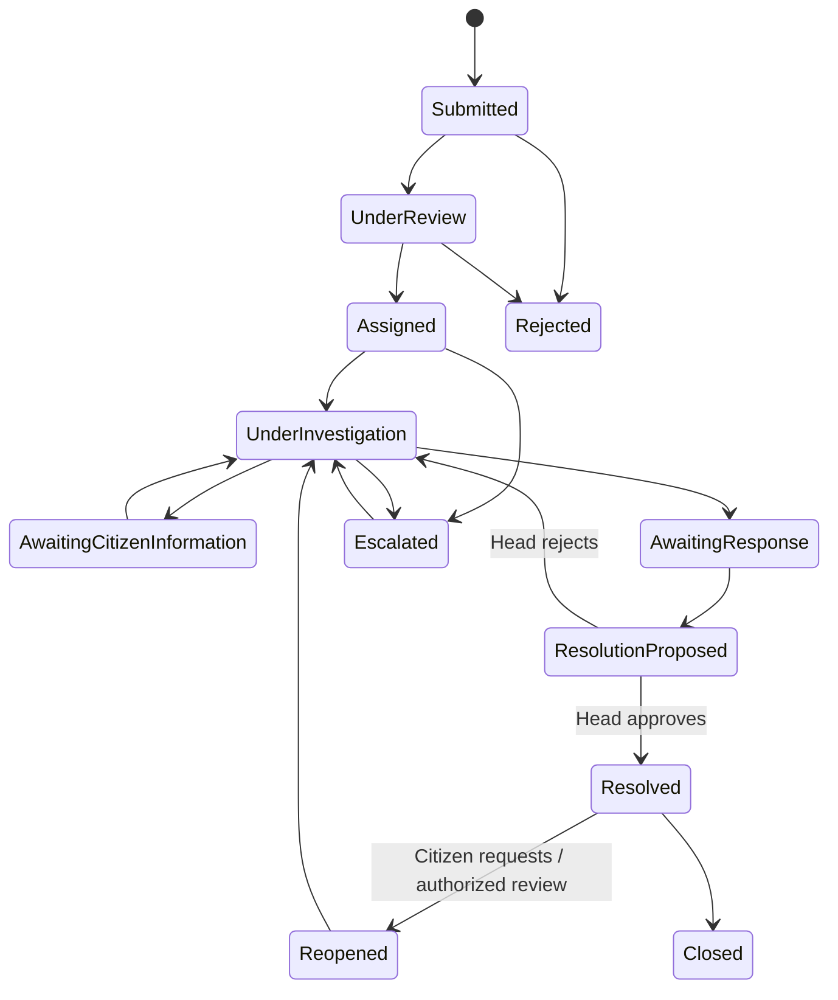

# System Architecture and Workflows

**Milestone:** 2 - System design
**Status:** Draft for design review
**Baseline:** Approved Milestone 1 requirements

## 1. Architecture decision

Use a three-tier web architecture. React is the presentation layer, FastAPI is the only application interface to the database and MongoDB Atlas is the persistence layer. Private files are stored in an object/file storage provider selected later; MongoDB stores metadata and storage keys, not file bytes. Email is behind a notification adapter so a provider can be selected without coupling case workflows to one vendor.

The browser must never connect directly to MongoDB, storage credentials or a private provider API. Secrets stay server-side. Production deployment details are out of scope until the deployment milestone.

## 2. Backend module boundaries

- **API/presentation:** versioned HTTP routes, request/response validation, consistent errors.
- **Identity and authorization:** authentication, role checks, department and assignment scope.
- **Complaint application service:** state transitions, assignment rules, comments/events, feedback, deadlines.
- **Administration:** user, department, category and configuration management.
- **Notification service:** persist in-app notifications and enqueue/send email after successful domain actions.
- **Reporting service:** permission-scoped aggregation; public aggregates must exclude identifying details.
- **Persistence adapters:** MongoDB repositories, files storage adapter and email adapter.
- **Audit service:** append significant security and case-management actions; do not log secrets or complaint evidence.

Business rules belong in backend services, not only in React components. Every protected endpoint verifies authorization server-side.

## 3. Role and access boundaries

| Role | Data scope | Main permitted actions |
| Public visitor | Published public content and privacy-safe aggregates | Read information, FAQs, directory, announcements, guidelines, public aggregate stats |
| Citizen | Own user profile, own complaints, citizen-visible events and notifications | Submit, view own cases, provide requested information, rate/reopen per workflow |
| Administrator | System-wide case and configuration scope| Manage departments/categories/staff, route cases, investigate escalations, reports, system audit |
| Departmental head | Cases of their active department | Allocate officers, review proposed resolutions, respond/escalate, departmental reports |
| Departmental officer | Cases assigned to that officer in their department | Investigate, communicate, request information, propose resolution |

Rules: a department head or officer cannot widen their own department scope; officers cannot read an unassigned case; citizens cannot access other citizen's records; UI route guards are not security controls. Admin actions and staff role/department changes require audit events.

## 4. Complaint workflow

`Awaiting response` is intended to represent an internal department response/review wait; citizen-facing wording will be finalized with UI copy. Each transition must be validated against actor role, current state and department/assignment scope; require explanatory comments for rejection, escalation, resolution review rejection and reopening outcomes. Persist state change and event together. Exact status vocabulary and transition rules are a design-review item before implementation.

## 5. Key interaction sequences

### Submit a complaint
1. Citizen authenticates and submits validated fields to the API.
2. API verifies active citizen, active department/category and field/file rules.
3. Backend generates a cryptographically random reference and writes complaint plus initial event (transaction where supported).
4. Backend creates an in-app notification and queues an email notification without exposing private content unnecessarily.
5. API returns the new case summary and reference. The reference itself grants no access.

### Assign and investigate
1. Administrator assigns a case to a department; department head assigns it to an officer.
2. API verifies role, department, target user's active status and case state.
3. Assignment change, complaint update, event, audit record and notification are persisted consistently.
4. Assigned officer retrieves only cases within their assignment scope, records investigation updates and may request citizen information or submit a resolution proposal.

### Review resolution
1. Department head reads the proposal and authorized case context.
2. Head approves or rejects with a reason.
3. API checks state and department scope; records decision, event, audit record and notification.
4. On approval, complaint moves to resolved and becomes eligible for citizen feedback.

## 6. Deployment topology (logical)

Local development uses separate frontend/backend processes and a development MongoDB Atlas database or local MongoDB configuration. Frontend requests use a configurable API base URL. Production should use HTTPS, managed secret storage, restricted database network access, backups, monitoring and separate development/staging/production configuration. Exact hosts and providers are deferred.

## 7. Design acceptance checks

- All five roles and their data scopes are represented.
- Browser-to-API-to-database boundaries are explicit.
- Private attachments and provider credentials are not exposed to the browser.
- Workflow transitions and key actor checks are documented.
- The database and API contracts in companion documents support these flows.
- Unresolved design choices are listed rather than silently treated as settled.